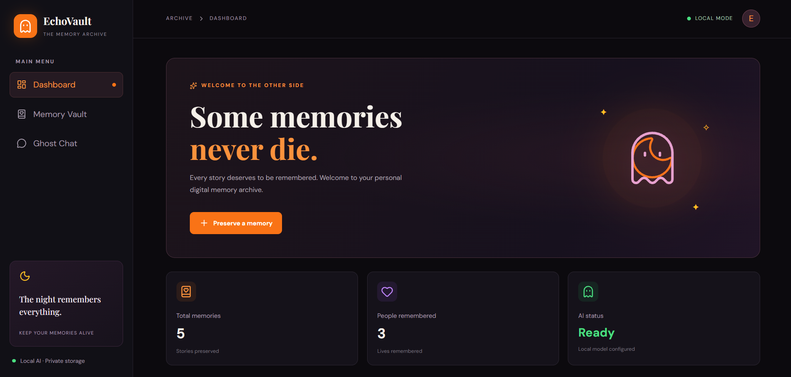
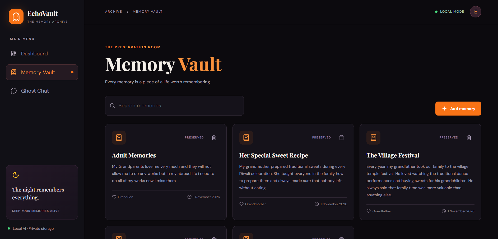
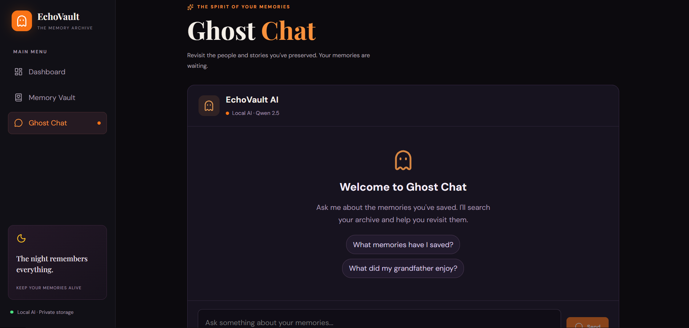
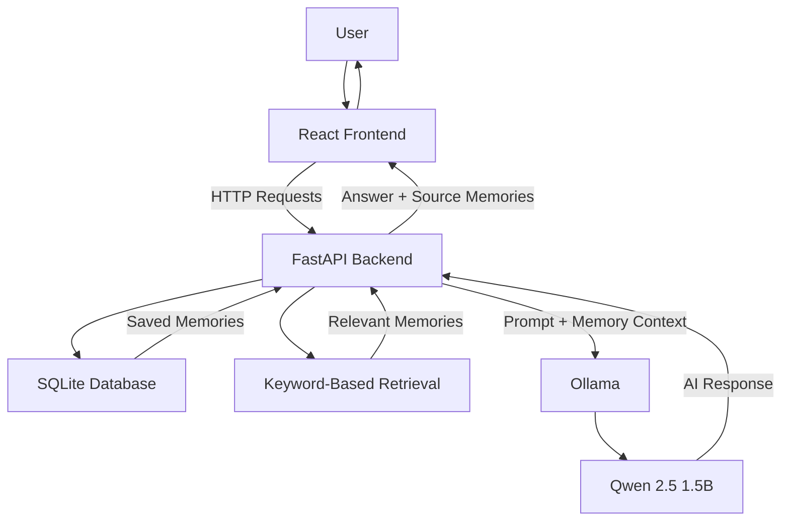

# 👻 EchoVault

### Some memories should never disappear.

EchoVault is a local-first, AI-powered memory preservation application that allows users to save personal stories, revisit meaningful moments, and interact with their memories through a locally running AI assistant.

Built around open-weight AI, EchoVault uses Ollama and Qwen 2.5 (1.5B) to provide AI-powered conversations without depending on cloud-based AI APIs.

Your memories are stored locally in an SQLite database, giving you control over your personal information.

---

## ✨ Features

- **Memory Vault:** Save personal stories with a person's name, memory title, and story description.
- **Ghost Chat:** Ask questions about saved memories and receive AI-generated answers.
- **Memory Retrieval:** Retrieve relevant memories using keyword matching and ranking.
- **Source References:** View the saved memories used to generate an answer.
- **Memory Management:** View, search, and delete saved memories.
- **Dashboard:** View memory statistics and recently saved memories.
- **Local AI Inference:** Run the AI assistant locally using Ollama and Qwen 2.5.
- **Privacy-Focused Storage:** Store memories in a local SQLite database.
- **Offline AI Experience:** Use the application without an internet connection after the required software and model have been installed.

---

## 📸 Application Screenshots

### Dashboard



### Memory Vault



### Ghost Chat



---

## 🖥️ Technology Stack

| Layer | Technology |
|---|---|
| Frontend | React 19 |
| Build Tool | Vite 8 |
| Styling | CSS |
| Icons | Lucide React |
| Backend | Python 3.12 |
| API Framework | FastAPI |
| API Server | Uvicorn |
| HTTP Client | Requests |
| Database | SQLite |
| AI Runtime | Ollama |
| AI Model | Qwen 2.5 1.5B |

---

## 🏗️ System Architecture



### How EchoVault Works

1. Users save personal stories through the React interface.
2. FastAPI receives the information and stores it in SQLite.
3. When a user asks a question, the backend searches the saved memories.
4. A keyword-based scoring mechanism ranks relevant memories.
5. The retrieved memory context is passed to the locally running Qwen model through Ollama.
6. The model generates an answer using the supplied memory context.
7. The frontend displays the answer and its source memories.

If no relevant saved memory is found, EchoVault returns a predefined response instead of asking the AI model to invent an answer.

---

## 🤖 Local AI Integration

EchoVault uses:

- **Ollama** as the local AI runtime.
- **Qwen 2.5 1.5B** as the open-weight language model.

The model runs on the user's machine and communicates with the Python backend through Ollama's local API.

Unlike applications that depend on external cloud AI APIs, EchoVault can perform its AI inference locally after installation and model download.

---

## 🔒 Privacy and Offline Functionality

EchoVault follows a local-first approach.

- Memories are stored in a local SQLite database.
- AI inference runs locally through Ollama.
- No external cloud AI API is required for chat responses.
- Saved memories remain on the user's machine.

**Note:** Internet access is required initially to install dependencies and download the AI model. Once setup is complete, the core application and AI inference can operate offline.

---

## 📁 Project Structure

```text
EchoVault/
│
├── Backend/
│   ├── main.py
│   ├── database.py
│   └── requirements.txt
│
├── Frontend/
│   ├── public/
│   ├── src/
│   │   ├── assets/
│   │   │   └── hero.png
│   │   ├── App.jsx
│   │   ├── App.css
│   │   ├── index.css
│   │   └── main.jsx
│   ├── index.html
│   ├── package.json
│   └── vite.config.js
│
├── screenshots/
│   ├── dashboard.png
│   ├── memory-vault.png
│   └── ghost-chat.png
│
├── .gitignore
├── LICENSE
└── README.md
```

**Note:** The local virtual environment, installed frontend dependencies, and personal SQLite database are excluded from version control.

---

## ⚙️ Installation and Setup

### Prerequisites

Install the following:

- Python 3.12 or later
- Node.js and npm
- Ollama

### 1. Clone the Repository

```bash
git clone https://github.com/darshan2006-coder/EchoVault.git
cd EchoVault
```

### 2. Set Up the AI Model

Install Ollama from:

https://ollama.com/

Download the model:

```bash
ollama pull qwen2.5:1.5b
```

Verify the model:

```bash
ollama list
```

### 3. Set Up the Backend

Open a terminal:

```bash
cd Backend
```

Create a virtual environment:

```bash
python -m venv venv
```

Activate it on Windows PowerShell:

```powershell
.\venv\Scripts\Activate.ps1
```

Install the dependencies:

```bash
pip install -r requirements.txt
```

Start the backend:

```bash
uvicorn main:app --reload
```

Backend API:

http://localhost:8000

Interactive API documentation:

http://localhost:8000/docs

### 4. Set Up the Frontend

Open another terminal from the project root:

```bash
cd Frontend
```

Install dependencies:

```bash
npm install
```

Start the development server:

```bash
npm run dev
```

Open the application:

http://localhost:5173

---

## 🔌 API Endpoints

| Method | Endpoint | Description |
|---|---|---|
| GET | `/` | Backend health check |
| POST | `/memories` | Save a memory |
| GET | `/memories` | Retrieve saved memories |
| DELETE | `/memories/{memory_id}` | Delete a memory |
| POST | `/chat` | Ask the AI assistant a question |

---

## 🎃 Why EchoVault?

Memories are an important part of our identity. However, personal stories and meaningful experiences can easily get lost over time.

EchoVault explores how local AI can help preserve and revisit those memories while keeping personal information under the user's control.

The project demonstrates how open-weight AI makes it possible to build useful AI applications without relying entirely on centralized cloud services.

---

## 🚀 Future Improvements

- Semantic search using local embeddings.
- Memory timeline and chronological exploration.
- Voice-based memory recording.
- Memory export and backup functionality.
- Improved memory retrieval and ranking.
- Support for additional local language models.

---

## 🤝 Contributing

Contributions, suggestions, and improvements are welcome!

If you would like to improve EchoVault, feel free to fork the repository and submit a pull request.

---

## 📜 License

EchoVault is licensed under the [MIT License](LICENSE).

Copyright © 2026 Darshan R.

You are free to use, modify, and distribute this software in accordance with the terms of the MIT License.

---

**EchoVault — Some memories should never disappear.**